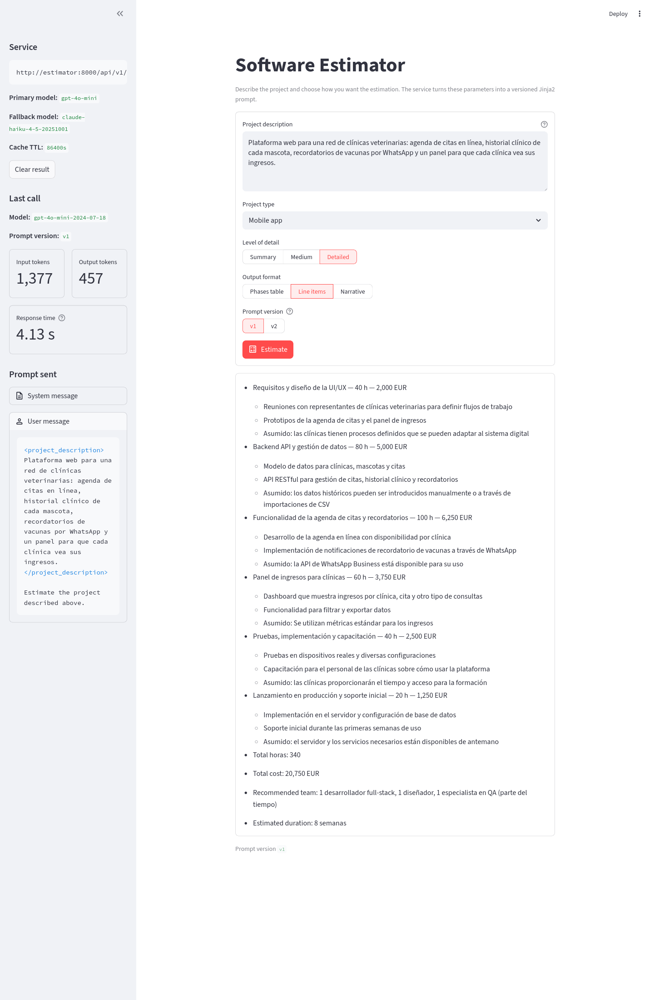

# Estimator CAG - Servicio de Estimacion de Software con IA

Servicio de estimacion de proyectos de software impulsado por IA, utilizando una arquitectura **Cache Augmented Generation (CAG)**.

## Que es CAG y por que lo usamos

CAG (Cache Augmented Generation) es un patron de arquitectura donde el contexto relevante se inyecta directamente en el prompt del LLM como texto estatico. En esta fase del proyecto, las estimaciones de referencia se incluyen como ejemplos dentro del prompt del sistema, sin necesidad de una base de datos vectorial ni busqueda semantica.

Este enfoque es ideal para empezar porque:
- Es simple de implementar y depurar
- No requiere infraestructura adicional (ni embeddings, ni vector stores)
- Funciona bien cuando el volumen de contexto es manejable (pocos ejemplos)

En modulos posteriores del master, este servicio evolucionara a una arquitectura **RAG** (Retrieval Augmented Generation) con base de datos vectorial para manejar un volumen mayor de ejemplos.

## Requisitos previos

- **Docker** y **Docker Compose** instalados
- Una **API key** de OpenAI o Anthropic
- Python **NO** es necesario localmente — todo se ejecuta dentro del contenedor

## Inicio rapido con Docker (recomendado)

1. Clonar el repositorio y entrar al directorio:
   ```bash
   cd estimator
   ```

2. Copiar el archivo de variables de entorno y configurar las API keys:
   ```bash
   cp .env.example .env
   # Editar .env y poner tu API key real
   ```

3. Construir y levantar el servicio:
   ```bash
   docker compose up --build
   ```

4. La UI (formulario Streamlit) queda en `http://localhost:8501` y la API en `http://localhost:8000`

## Alternativa: ejecucion local sin Docker

```bash
uv sync
# Configurar .env con tus API keys
uv run uvicorn app.main:app --reload
```

## Ejecutar los tests

```bash
cd estimator
uv sync                                   # instala tambien pytest, ruff y fakeredis
uv run pytest                             # suite completa (~0.4 s, sin llamadas a APIs)
uv run pytest tests/prompts -v            # solo los tests de templates
uv run ruff check .                       # lint
```

Ningun test llama a OpenAI ni a Anthropic: el wrapper se sustituye por un stub y Redis
por `fakeredis`, asi que la suite corre igual sin API keys.

## Probar el servicio

```bash
curl -X POST "http://localhost:8000/api/v1/estimate?prompt_version=v1" \
  -H "Content-Type: application/json" \
  -d '{
    "description": "App movil para que los socios de un club de padel reserven pistas, paguen con tarjeta y reciban recordatorios.",
    "project_type": "mobile_app",
    "detail_level": "medium",
    "output_format": "phases_table"
  }'
```

Respuesta: `{"text": "...", "prompt_version": "v1", "model": ..., "usage": {...}, ...}`.

## Estructura del proyecto

```
estimator/
├── app/
│   ├── main.py                  # Aplicacion FastAPI, health check, CORS
│   ├── config.py                # Configuracion con Pydantic Settings
│   ├── dependencies.py          # Singletons de cache Redis y LLMWrapper (Depends)
│   ├── routers/
│   │   └── estimations.py       # POST /estimate, POST /estimate/stream (SSE),
│   │                            #   POST /prompt/preview y GET /prompts/versions
│   ├── prompts/
│   │   ├── loader.py            # render_estimation_prompt(request, version) -> (system, user)
│   │   └── estimation/
│   │       ├── v1/              # system.j2, user.j2, examples.j2
│   │       └── v2/              # Igual que v1 con tono orientado a cliente
│   ├── services/
│   │   ├── llm_wrapper.py       # LiteLLM Router: fallback primario -> secundario,
│   │   │                        #   cache, coste y uso de tokens en streaming
│   │   └── cache.py             # Cache exact-match en Redis
│   └── schemas/
│       └── estimation.py        # Contrato tipado: enums, EstimationRequest/Response
├── tests/
│   ├── conftest.py              # Fixture compartida (TestClient de FastAPI)
│   ├── prompts/
│   │   ├── test_estimation_v1.py  # Tests del template v1 (sin LLM)
│   │   └── test_estimation_v2.py  # Diferencias deliberadas de v2
│   ├── test_health.py           # Health check
│   ├── test_estimate_endpoint.py  # POST /estimate, versiones, validacion, preview
│   ├── test_estimate_stream.py  # Streaming SSE y evento metrics
│   ├── test_llm_wrapper.py      # Fallback del Router, cache, coste y metricas
│   └── test_cache.py            # Cache Redis (fakeredis)
├── assets/
│   └── session4-form.png        # Captura de la interfaz de la sesion 4
├── streamlit_app.py             # Formulario tipado (streaming opcional) + sidebar
├── Dockerfile                   # Build multi-stage con uv (API y Streamlit)
├── docker-compose.yml           # API, Streamlit y Redis para desarrollo local
├── .env.example                 # Variables de entorno de referencia
└── pyproject.toml               # Dependencias y configuracion
```

## Documentacion interactiva

Con el servicio corriendo, accede a la documentacion Swagger UI en:

- **Swagger UI:** [http://localhost:8000/docs](http://localhost:8000/docs)
- **ReDoc:** [http://localhost:8000/redoc](http://localhost:8000/redoc)

## Sesion 4 — Del chat a la interfaz de producto



El estimador deja de ser un chat. Dos cambios que nacen de la misma decision:

1. **Formulario tipado en vez de textarea libre.** El cliente envia un
   `EstimationRequest` con `description` (20-2000 caracteres), `project_type`,
   `detail_level` y `output_format` como enums. El espacio de tareas es acotado, asi
   que el producto decide como se pregunta al modelo y el usuario solo aporta datos.
   Streamlit reutiliza la misma clase Pydantic que valida el servicio, por lo que un
   formulario invalido se rechaza antes de salir del navegador.
2. **El prompt sale del codigo a templates Jinja2 versionados** en
   `app/prompts/estimation/<version>/`:
   - `system.j2` — rol, reglas, un bloque `` por `output_format` y otro por
     `detail_level` (con `detailed` pide listar las asunciones de cada fase), e
     `` de los ejemplos.
   - `user.j2` — la descripcion dentro de `<project_description>`.
   - `examples.j2` — tres estimaciones few-shot inventadas. Se definen una vez como
     datos y se pintan en el mismo formato y nivel de detalle pedidos, para que los
     ejemplos nunca contradigan las instrucciones.

`render_estimation_prompt(request, version="v1")` usa `StrictUndefined` (una variable
mal escrita rompe el render en vez de producir un hueco vacio), `trim_blocks` y
`lstrip_blocks`. El endpoint envia `system` y `user` como mensajes separados.

### El formulario (Streamlit)

- **Campos:** descripcion, tipo de proyecto, nivel de detalle, formato de salida y
  version del prompt (la lista sale de `GET /api/v1/prompts/versions`).
- **Stream the answer** (activado por defecto): llama a `POST /api/v1/estimate/stream`
  y pinta el texto con `st.write_stream` mientras el modelo lo genera. Desactivado,
  usa `POST /api/v1/estimate` y muestra la respuesta completa de golpe. Es el mismo
  prompt y la misma cache: solo cambia el transporte. Las metricas del sidebar salen
  del evento `metrics` del stream o del `EstimationResponse`.
- **Sidebar:** modelo que respondio, version del prompt, tokens de entrada y salida,
  tiempo de respuesta, aviso *Served from Redis cache* y los mensajes `system` / `user`
  exactos enviados (via `POST /api/v1/prompt/preview`, sin coste de tokens).
- **Clear result** solo limpia la pantalla (`st.session_state`); **no** borra la cache
  de Redis, que es compartida por todos los clientes. Para forzar una llamada real,
  cambia algun parametro del formulario o borra la cache (ver
  [Verificar la cache](#verificar-la-cache)).

### Notas didacticas en el codigo

El codigo de la sesion lleva comentarios `NOTA:` en espanol que explican que hace cada
pieza y por que (loader Jinja2, templates, schemas, router, SSE, Streamlit, tests,
cache y Router). Para recorrerlas:

```bash
grep -rn "NOTA" app/ tests/ streamlit_app.py
```

En los `.j2` las notas son comentarios Jinja (`{#  #}`), que **no** llegan al modelo:
el prompt renderizado es identico con y sin ellas.

### Versionado de prompts

- Una version publicada **no se edita**: para cambiar el prompt se crea `v2/` junto a
  `v1/`. Asi cada `prompt_version` registrado apunta siempre al texto exacto que
  produjo una respuesta, y se pueden comparar versiones con el mismo input.
- `v2` cambia **una sola cosa** respecto a `v1`: un tono orientado al cliente no
  tecnico, con resumen ejecutivo al inicio. Mismos ejemplos y mismo mensaje de usuario.
- Se elige con `?prompt_version=v2` (o el selector del formulario). Una version
  inexistente devuelve 422; solo se aceptan directorios que existen en disco.
- La clave de cache incluye el prompt renderizado, asi que cambiar de version o de
  parametro invalida la cache sin hacer nada.
- Cada render emite el log `prompt_rendered` con la version y un hash corto del
  contenido, para saber en produccion que prompt exacto se uso.

### Que cubren los tests de template (y que no)

`tests/prompts/` comprueba el **texto renderizado**: que la descripcion aparece literal
dentro de `<project_description>`, que `phases_table` / `confidence_pct` solo aparecen
con ese formato, que la instruccion de asunciones por fase solo aparece con
`detailed`, que las 36 combinaciones renderizan sin restos de Jinja, que una version
desconocida falla y que `StrictUndefined` rompe ante una variable mal escrita. Corren
en milisegundos y sin red.

**No** dicen nada de la calidad de la respuesta del modelo: que el LLM respete el
formato, acierte las horas o no invente requisitos se evalua aparte (evals y
guardrails, siguientes sesiones).

### Endpoints

| Metodo | Ruta | Uso |
|---|---|---|
| `POST` | `/api/v1/estimate?prompt_version=v1` | Estimacion completa (`EstimationResponse`) |
| `POST` | `/api/v1/estimate/stream?prompt_version=v1` | La misma estimacion por SSE (`token`, `metrics`, `done`) |
| `POST` | `/api/v1/prompt/preview?prompt_version=v1` | `(system, user)` renderizados, sin llamar al LLM |
| `GET` | `/api/v1/prompts/versions` | Versiones disponibles (`["v1", "v2"]`) |

## Sesion 3 — LiteLLM, Redis cache, SSE y Streamlit

A partir de la Sesion 3 el servicio incorpora una capa de wrapper sobre el LLM que anade:

- **Fallback de proveedor** (LiteLLM Router) — si el modelo primario falla, se intenta el secundario
- **Cache exact-match** en Redis — la misma transcripcion no vuelve a pagar tokens
- **Streaming SSE** — endpoint `POST /api/v1/estimate/stream` que emite los tokens segun llegan
- **UI Streamlit** — cliente real del servicio (en la sesion 4 pasa a ser un formulario)

### Fallback real: un grupo por modelo en el Router

El Router de LiteLLM agrupa los despliegues por `model_name`. Si el primario y el
fallback comparten nombre, el Router los trata como **intercambiables** y la estrategia
por defecto (`simple-shuffle`) reparte el trafico entre ambos: en una prueba de 200
llamadas, 87 fueron a Claude aunque OpenAI respondia bien. Eso no es un fallback, es
un balanceo de carga (y Claude Haiku cuesta ~7x mas por token que `gpt-4o-mini`).

Para que el secundario se use **solo cuando el primario falla**, cada modelo vive en su
propio grupo y `fallbacks` enlaza uno con otro (`app/services/llm_wrapper.py`):

```python
PRIMARY_GROUP = "estimator"
FALLBACK_GROUP = "estimator-fallback"

Router(
    model_list=[
        {"model_name": PRIMARY_GROUP, "litellm_params": {"model": primary_model, ...}},
        {"model_name": FALLBACK_GROUP, "litellm_params": {"model": fallback_model, ...}},
    ],
    fallbacks=[{PRIMARY_GROUP: [FALLBACK_GROUP]}],
    num_retries=num_retries,
)

# Todas las llamadas van al grupo primario; LiteLLM salta al fallback si falla
self.router.completion(model=PRIMARY_GROUP, ...)
```

Resultado: el 100% de las llamadas sanas las responde `PRIMARY_MODEL`, y con OpenAI
caido (p. ej. una API key invalida) responde `FALLBACK_MODEL`. El modelo que
realmente respondio aparece en el sidebar de Streamlit y en el log `llm_call_completed`
/ `llm_stream_completed`. El test
`test_router_always_picks_primary_and_falls_back_on_failure` evita que se vuelvan a
juntar en un mismo grupo.

Para que el fallback funcione hace falta `ANTHROPIC_API_KEY` en `.env`; sin ella la
app arranca igual pero no tiene respaldo.

### Arrancar la stack completa

```bash
cd estimator
docker compose up --build
# La API queda en http://localhost:8000, Streamlit en http://localhost:8501
# y Redis en redis://localhost:6379
```

### Probar el endpoint SSE

```bash
curl -N -X POST http://localhost:8000/api/v1/estimate/stream \
  -H 'Content-Type: application/json' \
  -d '{"description": "Small CRM with auth, contacts and roles. MVP in six weeks.",
       "project_type": "web_saas", "detail_level": "summary", "output_format": "line_items"}'
```

### Verificar la cache

```bash
# La misma peticion dos veces — la segunda devuelve cache_hit: true
curl -s localhost:8000/api/v1/estimate -H 'Content-Type: application/json' \
  -d '{"description": "Small CRM with auth, contacts and roles. MVP in six weeks.",
       "project_type": "web_saas", "detail_level": "summary", "output_format": "line_items"}' \
  | jq '{cache_hit, cost_usd}'

# Inspeccionar las claves en Redis
docker compose exec redis redis-cli KEYS 'estimation:*'

# Borrar solo las estimaciones cacheadas (o todo Redis con FLUSHDB)
docker compose exec redis sh -c 'redis-cli --scan --pattern "estimation:*" | xargs -r redis-cli del'
```

### Streamlit

Streamlit levanta con `docker compose up` como el servicio `streamlit` y llama a la API
por HTTP. Abrir [http://localhost:8501](http://localhost:8501).
Dentro de la red de compose apunta a `http://estimator:8000`.

Para correrlo **fuera** de Docker (contra la API en `localhost:8000`):

```bash
cd estimator
uv sync
uv run streamlit run streamlit_app.py
```

La URL del backend se lee de `ESTIMATOR_API_BASE_URL` (default `http://localhost:8000`).

---

> Este proyecto forma parte del **Master en AI Engineering** y servira como base para evolucionar hacia una arquitectura RAG con base de datos vectorial en modulos posteriores.
